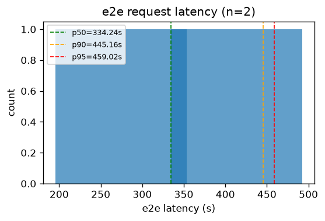
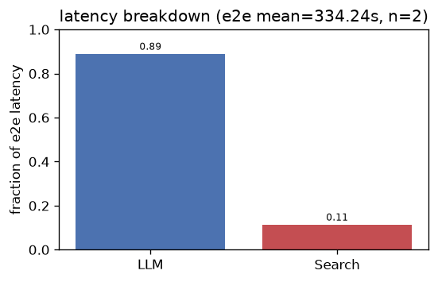
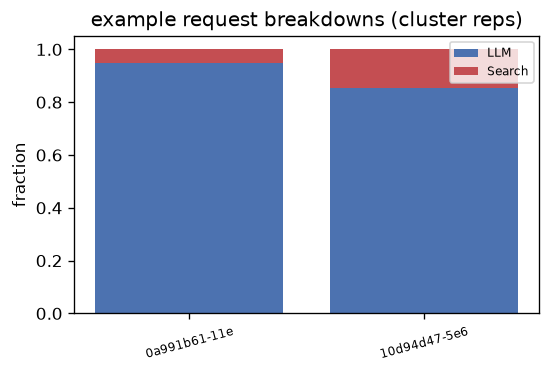
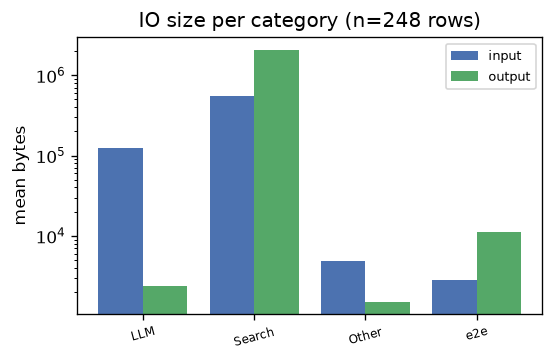
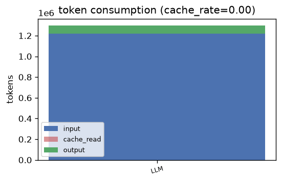

# deepresearch — Analysis Report

## 1. E2E Request Latency
- **Requests**: 2
- **Mean**: 334.24s | **Std**: 138.65s
- **p50**: 334.24s | **p90**: 445.16s | **p95**: 459.02s | **p99**: 470.12s
- **Min**: 195.58s | **Max**: 472.89s

## 2. Latency Breakdown
- **E2E mean**: 334.24s | **Requests**: 2

| Category | Fraction |
|----------|----------|
| LLM | 88.8% |
| Search | 11.2% |

### Representative request breakdowns

## 3. IO Size per Category

| Category | Input (mean) | Input (p95) | Output (mean) | Output (p95) | Calls |
|----------|-------------|-------------|--------------|--------------|-------|
| LLM | 121.8 KB | 325.5 KB | 2.3 KB | 3.1 KB | 158 |
| Other | 4.8 KB | 7.8 KB | 1.5 KB | 1.7 KB | 22 |
| Search | 537.1 KB | 1.9 MB | 2.0 MB | 10.4 MB | 64 |
| e2e | 2.7 KB | 2.8 KB | 10.8 KB | 11.5 KB | 4 |

- **Total IO records**: 248

## 4. Token Consumption
- **Cache rate**: 0.0%
- **Total input**: 1,216,886 | **Total output**: 82,439
- **Cache read**: 0 | **Reasoning**: 0

| Category | Input | Output | Cache Read | Reasoning | Calls |
|----------|-------|--------|------------|-----------|-------|
| LLM | 1,216,886 | 82,439 | 0 | 0 | 78 |

---
*Generated by `benchmark/analysis/run.py` — see [README](../README.md) for usage.*