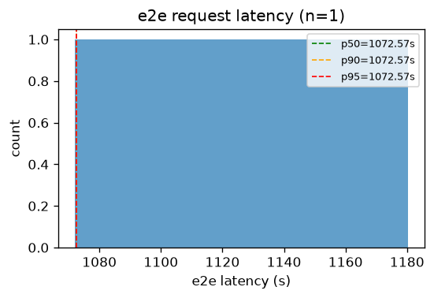
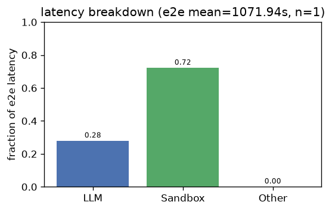
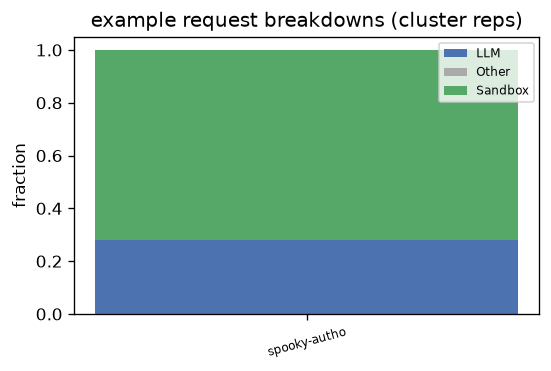
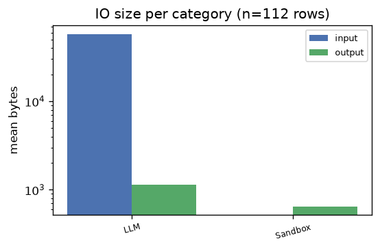
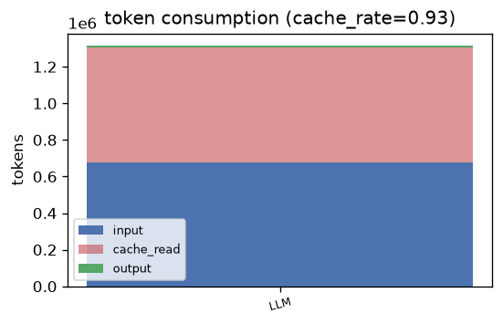

# pi_autoresearch — Analysis Report

## 1. E2E Request Latency
- **Requests**: 1
- **Mean**: 1072.57s | **Std**: 0.00s
- **p50**: 1072.57s | **p90**: 1072.57s | **p95**: 1072.57s | **p99**: 1072.57s
- **Min**: 1072.57s | **Max**: 1072.57s

## 2. Latency Breakdown
- **E2E mean**: 1071.94s | **Requests**: 1

| Category | Fraction |
|----------|----------|
| Sandbox | 72.1% |
| LLM | 27.9% |
| Other | 0.0% |

### Representative request breakdowns

## 3. IO Size per Category

| Category | Input (mean) | Input (p95) | Output (mean) | Output (p95) | Calls |
|----------|-------------|-------------|--------------|--------------|-------|
| LLM | 56.4 KB | 83.4 KB | 1.1 KB | 4.8 KB | 72 |
| Sandbox | 0 B | 0 B | 648 B | 2.9 KB | 40 |

- **Total IO records**: 112

## 4. Token Consumption
- **Cache rate**: 92.8%
- **Total input**: 676,087 | **Total output**: 13,126
- **Cache read**: 627,712 | **Reasoning**: 0

| Category | Input | Output | Cache Read | Reasoning | Calls |
|----------|-------|--------|------------|-----------|-------|
| LLM | 676,087 | 13,126 | 627,712 | 0 | 36 |

---
*Generated by `benchmark/analysis/run.py` — see [README](../README.md) for usage.*