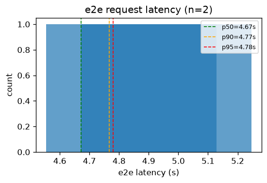
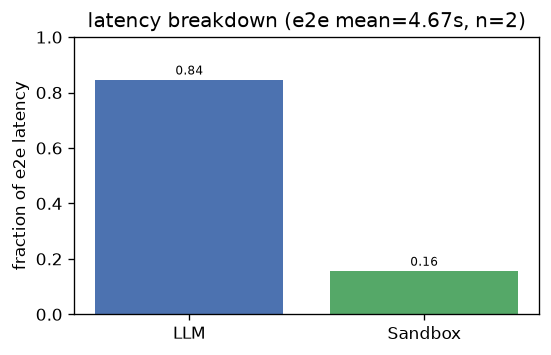
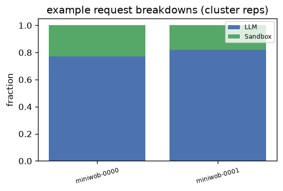
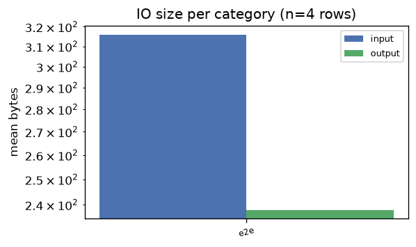
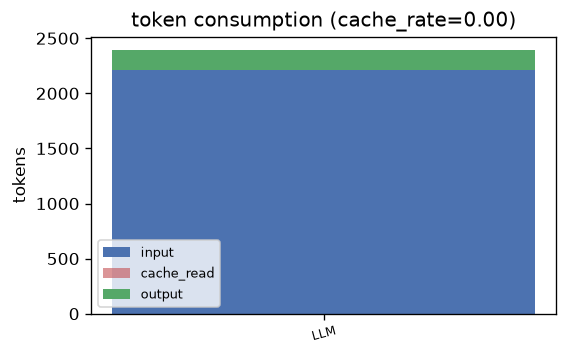

# webagent — Analysis Report

## 1. E2E Request Latency
- **Requests**: 2
- **Mean**: 4.67s | **Std**: 0.12s
- **p50**: 4.67s | **p90**: 4.77s | **p95**: 4.78s | **p99**: 4.79s
- **Min**: 4.55s | **Max**: 4.79s

## 2. Latency Breakdown
- **E2E mean**: 4.67s | **Requests**: 2

| Category | Fraction |
|----------|----------|
| LLM | 84.5% |
| Sandbox | 15.5% |

### Representative request breakdowns

## 3. IO Size per Category

| Category | Input (mean) | Input (p95) | Output (mean) | Output (p95) | Calls |
|----------|-------------|-------------|--------------|--------------|-------|
| e2e | 316 B | 318 B | 238 B | 240 B | 4 |

- **Total IO records**: 4

## 4. Token Consumption
- **Cache rate**: 0.0%
- **Total input**: 2,213 | **Total output**: 183
- **Cache read**: 0 | **Reasoning**: 169

| Category | Input | Output | Cache Read | Reasoning | Calls |
|----------|-------|--------|------------|-----------|-------|
| LLM | 2,213 | 183 | 0 | 169 | 2 |

---
*Generated by `benchmark/analysis/run.py` — see [README](../README.md) for usage.*