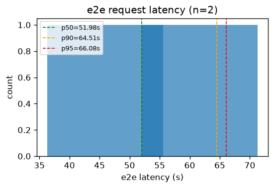
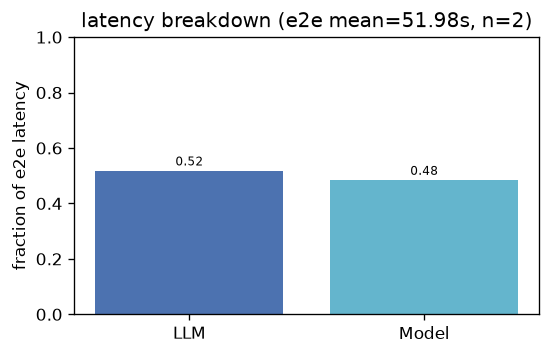
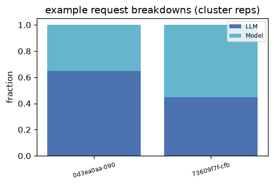
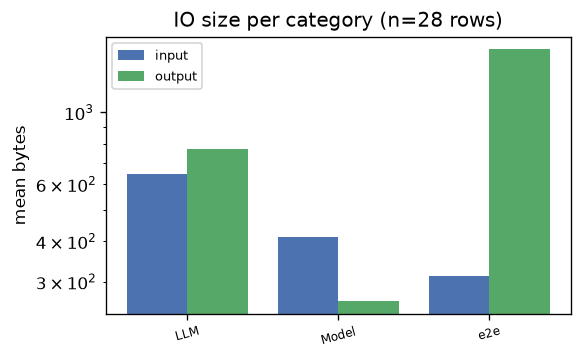
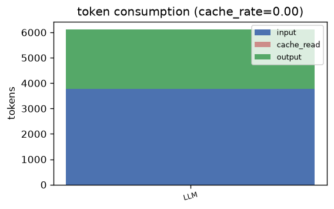

# hugginggpt — Analysis Report

## 1. E2E Request Latency
- **Requests**: 2
- **Mean**: 51.98s | **Std**: 15.67s
- **p50**: 51.98s | **p90**: 64.51s | **p95**: 66.08s | **p99**: 67.33s
- **Min**: 36.31s | **Max**: 67.65s

## 2. Latency Breakdown
- **E2E mean**: 51.98s | **Requests**: 2

| Category | Fraction |
|----------|----------|
| LLM | 51.7% |
| Model | 48.3% |

### Representative request breakdowns

## 3. IO Size per Category

| Category | Input (mean) | Input (p95) | Output (mean) | Output (p95) | Calls |
|----------|-------------|-------------|--------------|--------------|-------|
| LLM | 647 B | 910 B | 771 B | 1.7 KB | 16 |
| Model | 412 B | 431 B | 261 B | 276 B | 8 |
| e2e | 312 B | 312 B | 1.5 KB | 1.9 KB | 4 |

- **Total IO records**: 28

## 4. Token Consumption
- **Cache rate**: 0.0%
- **Total input**: 3,776 | **Total output**: 2,347
- **Cache read**: 0 | **Reasoning**: 0

| Category | Input | Output | Cache Read | Reasoning | Calls |
|----------|-------|--------|------------|-----------|-------|
| LLM | 3,776 | 2,347 | 0 | 0 | 4 |

---
*Generated by `benchmark/analysis/run.py` — see [README](../README.md) for usage.*