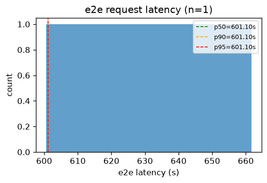
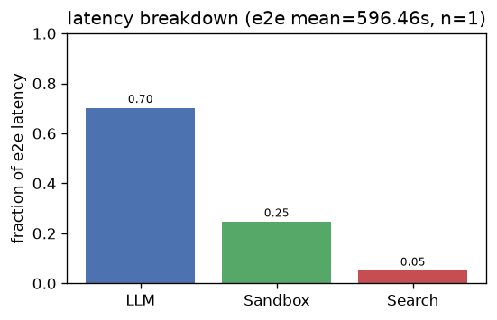
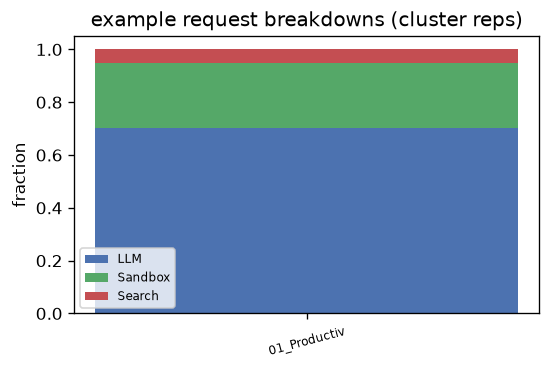
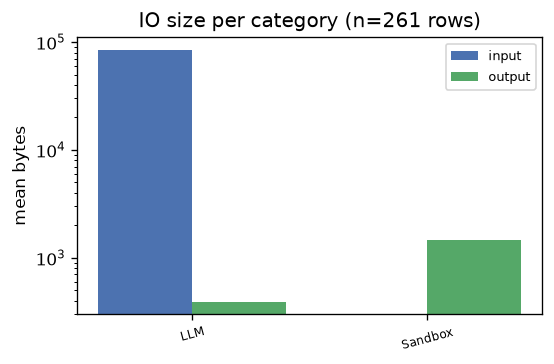
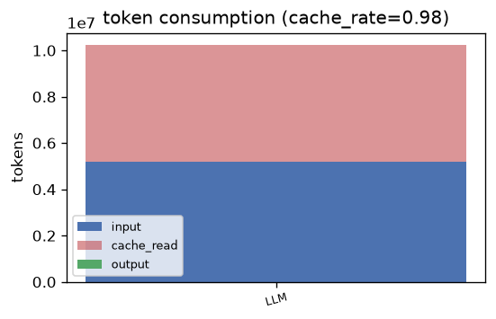

# openclaw — Analysis Report

## 1. E2E Request Latency
- **Requests**: 1
- **Mean**: 601.10s | **Std**: 0.00s
- **p50**: 601.10s | **p90**: 601.10s | **p95**: 601.10s | **p99**: 601.10s
- **Min**: 601.10s | **Max**: 601.10s

## 2. Latency Breakdown
- **E2E mean**: 596.46s | **Requests**: 1

| Category | Fraction |
|----------|----------|
| LLM | 70.2% |
| Sandbox | 24.7% |
| Search | 5.1% |

### Representative request breakdowns

## 3. IO Size per Category

| Category | Input (mean) | Input (p95) | Output (mean) | Output (p95) | Calls |
|----------|-------------|-------------|--------------|--------------|-------|
| LLM | 82.9 KB | 155.5 KB | 391 B | 1.6 KB | 174 |
| Sandbox | 0 B | 0 B | 1.4 KB | 8.0 KB | 87 |

- **Total IO records**: 261

## 4. Token Consumption
- **Cache rate**: 97.6%
- **Total input**: 5,178,810 | **Total output**: 13,063
- **Cache read**: 5,056,512 | **Reasoning**: 0

| Category | Input | Output | Cache Read | Reasoning | Calls |
|----------|-------|--------|------------|-----------|-------|
| LLM | 5,178,810 | 13,063 | 5,056,512 | 0 | 87 |

---
*Generated by `benchmark/analysis/run.py` — see [README](../README.md) for usage.*