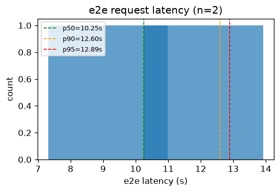
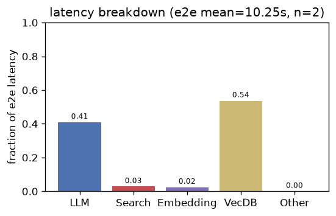
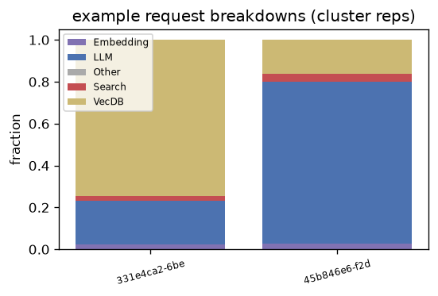
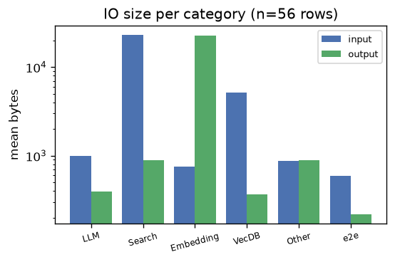
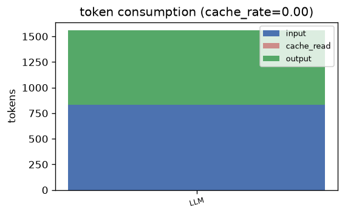

# rag — Analysis Report

## 1. E2E Request Latency
- **Requests**: 2
- **Mean**: 10.25s | **Std**: 2.94s
- **p50**: 10.25s | **p90**: 12.60s | **p95**: 12.89s | **p99**: 13.13s
- **Min**: 7.32s | **Max**: 13.19s

## 2. Latency Breakdown
- **E2E mean**: 10.25s | **Requests**: 2

| Category | Fraction |
|----------|----------|
| VecDB | 53.7% |
| LLM | 41.0% |
| Search | 2.8% |
| Embedding | 2.5% |
| Other | 0.0% |

### Representative request breakdowns

## 3. IO Size per Category

| Category | Input (mean) | Input (p95) | Output (mean) | Output (p95) | Calls |
|----------|-------------|-------------|--------------|--------------|-------|
| Embedding | 752 B | 1.4 KB | 22.2 KB | 22.2 KB | 8 |
| LLM | 986 B | 1.4 KB | 394 B | 443 B | 8 |
| Other | 872 B | 1.4 KB | 896 B | 1.2 KB | 8 |
| Search | 22.5 KB | 22.6 KB | 896 B | 1.2 KB | 4 |
| VecDB | 5.1 KB | 23.3 KB | 363 B | 1.2 KB | 20 |
| e2e | 594 B | 758 B | 218 B | 266 B | 8 |

- **Total IO records**: 56

## 4. Token Consumption
- **Cache rate**: 0.0%
- **Total input**: 830 | **Total output**: 732
- **Cache read**: 0 | **Reasoning**: 0

| Category | Input | Output | Cache Read | Reasoning | Calls |
|----------|-------|--------|------------|-----------|-------|
| LLM | 830 | 732 | 0 | 0 | 4 |

---
*Generated by `benchmark/analysis/run.py` — see [README](../README.md) for usage.*