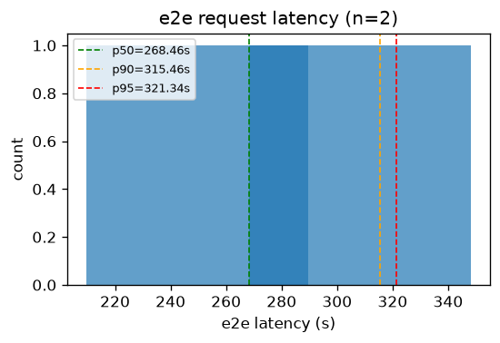
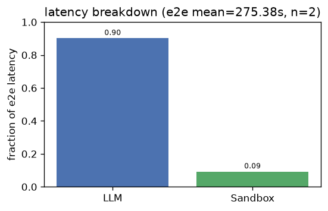
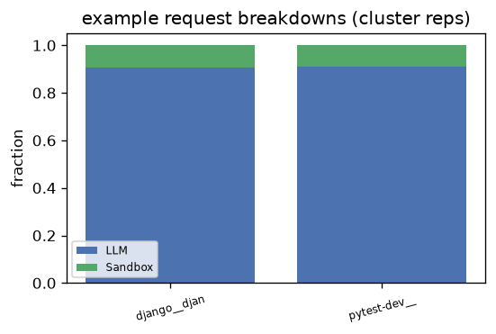
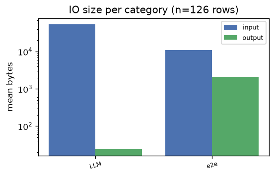
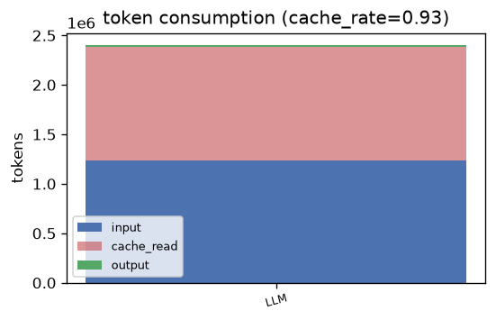

# mini_sweagent — Analysis Report

## 1. E2E Request Latency
- **Requests**: 2
- **Mean**: 268.46s | **Std**: 58.76s
- **p50**: 268.46s | **p90**: 315.46s | **p95**: 321.34s | **p99**: 326.04s
- **Min**: 209.71s | **Max**: 327.22s

## 2. Latency Breakdown
- **E2E mean**: 275.38s | **Requests**: 2

| Category | Fraction |
|----------|----------|
| LLM | 90.2% |
| Sandbox | 9.2% |

### Representative request breakdowns

## 3. IO Size per Category

| Category | Input (mean) | Input (p95) | Output (mean) | Output (p95) | Calls |
|----------|-------------|-------------|--------------|--------------|-------|
| LLM | 52.6 KB | 90.7 KB | 24 B | 101 B | 122 |
| e2e | 10.9 KB | 15.2 KB | 2.0 KB | 3.0 KB | 4 |

- **Total IO records**: 126

## 4. Token Consumption
- **Cache rate**: 92.7%
- **Total input**: 1,235,957 | **Total output**: 23,181
- **Cache read**: 1,145,856 | **Reasoning**: 11,808

| Category | Input | Output | Cache Read | Reasoning | Calls |
|----------|-------|--------|------------|-----------|-------|
| LLM | 1,235,957 | 23,181 | 1,145,856 | 11,808 | 61 |

---
*Generated by `benchmark/analysis/run.py` — see [README](../README.md) for usage.*