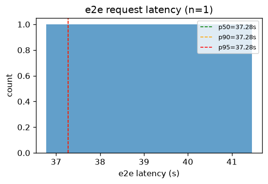
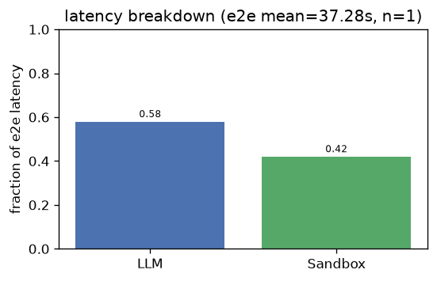
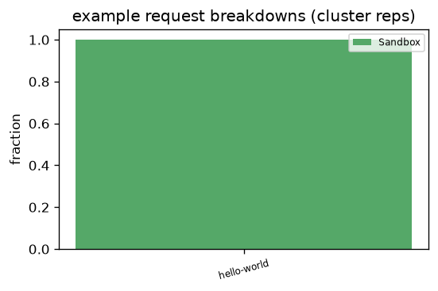
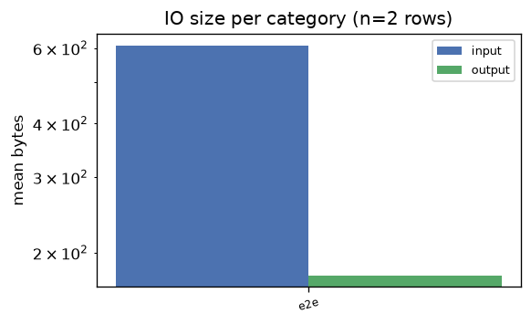
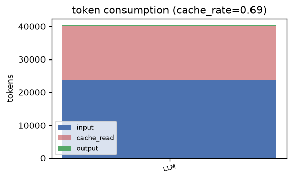

# codex — Analysis Report

## 1. E2E Request Latency
- **Requests**: 1
- **Mean**: 37.28s | **Std**: 0.00s
- **p50**: 37.28s | **p90**: 37.28s | **p95**: 37.28s | **p99**: 37.28s
- **Min**: 37.28s | **Max**: 37.28s

## 2. Latency Breakdown
- **E2E mean**: 37.28s | **Requests**: 1

| Category | Fraction |
|----------|----------|
| LLM | 58.0% |
| Sandbox | 42.0% |

### Representative request breakdowns

## 3. IO Size per Category

| Category | Input (mean) | Input (p95) | Output (mean) | Output (p95) | Calls |
|----------|-------------|-------------|--------------|--------------|-------|
| e2e | 609 B | 609 B | 177 B | 177 B | 2 |

- **Total IO records**: 2

## 4. Token Consumption
- **Cache rate**: 68.8%
- **Total input**: 23,818 | **Total output**: 181
- **Cache read**: 16,384 | **Reasoning**: 55

| Category | Input | Output | Cache Read | Reasoning | Calls |
|----------|-------|--------|------------|-----------|-------|
| LLM | 23,818 | 181 | 16,384 | 55 | 1 |

---
*Generated by `benchmark/analysis/run.py` — see [README](../README.md) for usage.*