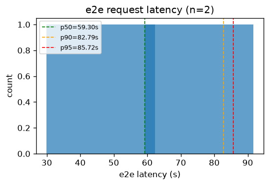
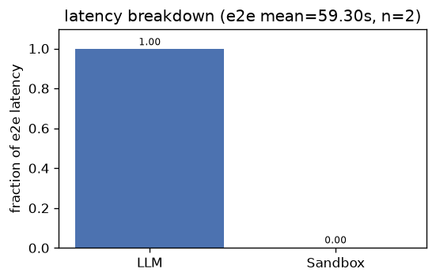
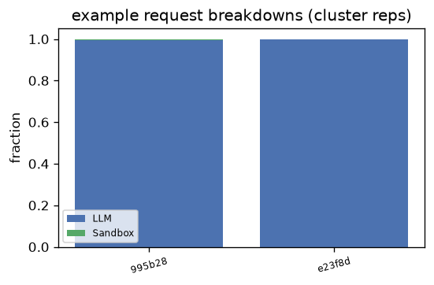
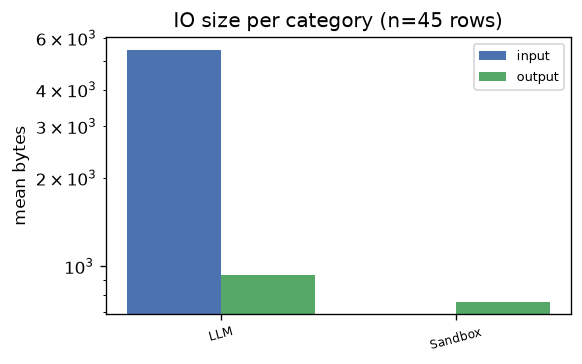
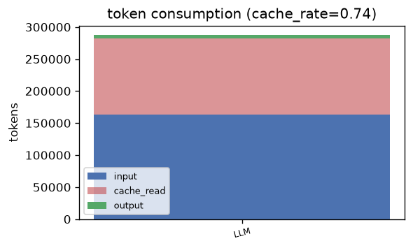

# claude — Analysis Report

## 1. E2E Request Latency
- **Requests**: 2
- **Mean**: 59.30s | **Std**: 29.36s
- **p50**: 59.30s | **p90**: 82.79s | **p95**: 85.72s | **p99**: 88.07s
- **Min**: 29.93s | **Max**: 88.66s

## 2. Latency Breakdown
- **E2E mean**: 59.30s | **Requests**: 2

| Category | Fraction |
|----------|----------|
| LLM | 99.7% |
| Sandbox | 0.3% |

### Representative request breakdowns

## 3. IO Size per Category

| Category | Input (mean) | Input (p95) | Output (mean) | Output (p95) | Calls |
|----------|-------------|-------------|--------------|--------------|-------|
| LLM | 5.3 KB | 15.4 KB | 931 B | 4.5 KB | 38 |
| Sandbox | 0 B | 0 B | 756 B | 2.5 KB | 7 |

- **Total IO records**: 45

## 4. Token Consumption
- **Cache rate**: 73.6%
- **Total input**: 162,846 | **Total output**: 5,325
- **Cache read**: 119,808 | **Reasoning**: 0

| Category | Input | Output | Cache Read | Reasoning | Calls |
|----------|-------|--------|------------|-----------|-------|
| LLM | 162,846 | 5,325 | 119,808 | 0 | 9 |

---
*Generated by `benchmark/analysis/run.py` — see [README](../README.md) for usage.*